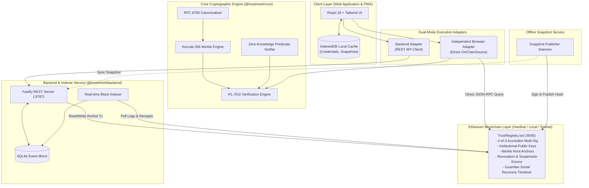

# TrustMesh: Decentralized Institutional Trust Infrastructure

[](#)
[](#)
[](#)
[](#)

> **Trust, Decentralized. Verify Anywhere.**  
> A zero-PII institutional trust protocol. Universities and enterprises issue cryptographically signed, Merkle-committed credentials; anyone verifies them on Ethereum in milliseconds without contacting the issuer or storing personal data on-chain.

---

## 1. Executive Summary & Pitch

Current educational and professional credential verification is broken:
- **Centralized Vulnerability**: Universities maintain fragile web portals that suffer frequent downtime, leak student records, and expose institutions to severe GDPR/FERPA liabilities.
- **Rampant Fraud**: Counterfeit diplomas and altered GPAs circulate unchecked because manual verification takes weeks of email exchanges.
- **Surveillance & Friction**: Existing verification platforms notify the issuer every time a student applies for a job, compromising student autonomy.

**TrustMesh solves this with an immutable on-chain trust anchor:**
1. **Zero Personal Data On-Chain**: The Ethereum smart contract stores only 32-byte hashes (`keccak256`), Merkle roots, status enums, and decentralized identifiers (`DIDs`). Personal data never touches the mempool.
2. **Deterministic Cryptographic Verification**: An R1..R10 evaluation engine rigorously checks signatures, Merkle paths, revocation mappings, and zero-knowledge predicate claims (`cgpa >= 8.0`).
3. **Dual-Engine Censorship Resistance**: Verifiers can run via the high-speed backend indexer or in **Independent Browser Mode** querying Ethereum JSON-RPC directly with zero backend trust.
4. **Holder Privacy & Selective Disclosure**: Holders present credentials while withholding sensitive attributes (e.g., proving graduation while concealing GPA).
5. **True Offline Mode (PWA)**: Field verifiers inspect credentials with zero network connectivity using signed snapshot caches stored in IndexedDB.

---

## 2. System Architecture



---

## 3. Quickstart & Local Setup

### Prerequisites
- Node.js >= 20.x
- npm >= 10.x
- Git

### One-Command Dev Setup
From the repository root:
```bash
# Install root orchestration dependencies
npm install

# Start local Hardhat Ethereum node, deploy contracts, run indexer, and launch frontend
npm run dev
```

The application will be live at:
- **Frontend Verifier & Console**: [http://localhost:5173](http://localhost:5173)
- **Backend REST API**: [http://localhost:8787](http://localhost:8787)
- **Ethereum RPC Node**: [http://localhost:8545](http://localhost:8545)

### Running Standalone Web App
```bash
cd web
npm install
npm run dev
```

### Running Test Suites
```bash
# Run Core cryptographic tests (97 tests)
cd core && npm test

# Run Web component & logic tests (9 tests)
cd web && npm test

# Build production bundle & PWA service worker
cd web && npm run build
```

---

## 4. Problem Statement & MVP Requirements Mapping

| # | Problem Statement Requirement | Product Implementation | Location in Codebase |
| :- | :--- | :--- | :--- |
| **1** | **Decentralized Trust Registry** | Smart contract with 2-of-3 accreditor consensus, institution lifecycles, and key registries. | [`contracts/contracts/TrustRegistry.sol`](file:///c:/Users/APURVA/OneDrive/Documents/Desktop/BlockForge/contracts/contracts/TrustRegistry.sol) |
| **2** | **Zero Personal Data On-Chain** | RFC 8785 canonicalization + salted Keccak-256 Merkle trees; only 32-byte roots anchored. | [`core/src/crypto.ts`](file:///c:/Users/APURVA/OneDrive/Documents/Desktop/BlockForge/core/src/crypto.ts), [`core/src/issuance.ts`](file:///c:/Users/APURVA/OneDrive/Documents/Desktop/BlockForge/core/src/issuance.ts) |
| **3** | **Deterministic Verification Engine** | Sequential evaluation of 10 cryptographic rules (R1..R10) producing trust scores and verdicts. | [`core/src/verify.ts`](file:///c:/Users/APURVA/OneDrive/Documents/Desktop/BlockForge/core/src/verify.ts), [`web/src/pages/VerifierPage.tsx`](file:///c:/Users/APURVA/OneDrive/Documents/Desktop/BlockForge/web/src/pages/VerifierPage.tsx) |
| **4** | **Dual Engine Parity (Browser & Backend)**| Verifier toggles between Backend node and Browser Direct RPC (`OnChainSource`) with side-by-side diff. | [`web/src/lib/api.ts`](file:///c:/Users/APURVA/OneDrive/Documents/Desktop/BlockForge/web/src/lib/api.ts), [`web/src/pages/VerifierPage.tsx`](file:///c:/Users/APURVA/OneDrive/Documents/Desktop/BlockForge/web/src/pages/VerifierPage.tsx) |
| **5** | **Holder Privacy & Selective Disclosure** | Local IndexedDB storage, attribute masking, zero-knowledge predicate claims, and presentation nonces. | [`web/src/pages/WalletPage.tsx`](file:///c:/Users/APURVA/OneDrive/Documents/Desktop/BlockForge/web/src/pages/WalletPage.tsx), [`core/src/issuance.ts`](file:///c:/Users/APURVA/OneDrive/Documents/Desktop/BlockForge/core/src/issuance.ts) |
| **6** | **Key Compromise Blast Radius** | Compromise timestamp marking, pre vs post-leak classification, and 2-of-2 guardian recovery. | [`web/src/pages/IncidentsPage.tsx`](file:///c:/Users/APURVA/OneDrive/Documents/Desktop/BlockForge/web/src/pages/IncidentsPage.tsx), [`core/src/blastRadius.ts`](file:///c:/Users/APURVA/OneDrive/Documents/Desktop/BlockForge/core/src/blastRadius.ts) |
| **7** | **Offline Mode (PWA)** | `vite-plugin-pwa` precache, IndexedDB snapshot caching, and strict 24-hour freshness rejection (R10). | [`web/src/pages/OfflinePage.tsx`](file:///c:/Users/APURVA/OneDrive/Documents/Desktop/BlockForge/web/src/pages/OfflinePage.tsx), [`core/src/snapshot.ts`](file:///c:/Users/APURVA/OneDrive/Documents/Desktop/BlockForge/core/src/snapshot.ts) |
| **8** | **Adversarial Fraud Playground** | 18 automated security attacks tested on-chain with scoreboard and live JSON mutation editor. | [`web/src/pages/PlaygroundPage.tsx`](file:///c:/Users/APURVA/OneDrive/Documents/Desktop/BlockForge/web/src/pages/PlaygroundPage.tsx), [`core/src/attacks.ts`](file:///c:/Users/APURVA/OneDrive/Documents/Desktop/BlockForge/core/src/attacks.ts) |
| **9** | **Immutable Audit & Direct Chain Proof** | Real-time event log with CSV export and browser direct RPC re-verification button. | [`web/src/pages/AuditPage.tsx`](file:///c:/Users/APURVA/OneDrive/Documents/Desktop/BlockForge/web/src/pages/AuditPage.tsx), [`backend/src/routes/audit.ts`](file:///c:/Users/APURVA/OneDrive/Documents/Desktop/BlockForge/backend/src/routes/audit.ts) |

---

## 5. The Four Mandatory Evaluation Scenarios

### Scenario 1: Happy Path — Valid Degree Credential
- **Action**: In the Verifier, load sample `"1. Valid Credential (100%)"` and click Verify.
- **Expected Result**:
  - Verdict Banner: **`VALID`** (Green).
  - Trust Score: **100/100**.
  - Rules R1 through R10 all evaluate to `PASS`.
  - Engine parity toggle confirms: `"Backend and browser agree ✔"`.

### Scenario 2: Field Tampering — CGPA Modified (9.4 &rarr; 9.9)
- **Action**: In the Verifier, load sample `"2. Tampered CGPA (Forensics)"`.
- **Expected Result**:
  - Verdict Banner: **`INVALID`** (Red).
  - Fails Rule **R5 (Merkle Leaf Integrity)**.
  - Forensics table highlights `cgpa: 9.9 [MUTATED]` with leaf mismatch badge.

### Scenario 3: Rogue Issuer — Unaccredited Institution
- **Action**: In the Verifier, load sample `"3. Rogue Issuer (Unapproved)"`.
- **Expected Result**:
  - Verdict Banner: **`INVALID`** (Red).
  - Fails Rule **R2 (Issuer Accreditation)**: Issuer DID lacks 2-of-3 accreditor approvals in the Trust Registry.

### Scenario 4: Revocation & Cross-Institution Protection
- **Action A**: In the Verifier, load sample `"4. Revoked Credential"`.
  - Fails Rule **R6 (On-Chain Revocation)** with reason `AcademicMisconduct`.
- **Action B**: In the Issuer Console (`/issuer`), click **"Try revoking as another institution"**.
  - Smart contract immediately reverts on-chain with custom error `NotIssuerOfCredential`.

---

## 6. Deployment & Infrastructure

Refer to [`infra/DEPLOY.md`](file:///c:/Users/APURVA/OneDrive/Documents/Desktop/BlockForge/infra/DEPLOY.md) for production deployment instructions across:
- **Ethereum EVM**: Sepolia / Arbitrum / Base deployment scripts.
- **Backend API**: Cloudflare Workers or Docker container.
- **Web Frontend**: Vercel SPA deployment configured in [`web/vercel.json`](file:///c:/Users/APURVA/OneDrive/Documents/Desktop/BlockForge/web/vercel.json).

---

## 7. Comprehensive Documentation Links

- [System Architecture Specification](file:///c:/Users/APURVA/OneDrive/Documents/Desktop/BlockForge/docs/ARCHITECTURE.md)
- [REST API & Core SDK Reference](file:///c:/Users/APURVA/OneDrive/Documents/Desktop/BlockForge/docs/API.md)
- [Threat Model & 18 Attack Matrix](file:///c:/Users/APURVA/OneDrive/Documents/Desktop/BlockForge/docs/THREAT_MODEL.md)
- [Troubleshooting & Judge FAQ](file:///c:/Users/APURVA/OneDrive/Documents/Desktop/BlockForge/docs/TROUBLESHOOTING.md)
- [5-Minute Judge Demo Script](file:///c:/Users/APURVA/OneDrive/Documents/Desktop/BlockForge/docs/DEMO_SCRIPT.md)
- [Pitch Deck & Likely Judge Q&A](file:///c:/Users/APURVA/OneDrive/Documents/Desktop/BlockForge/docs/PITCH.md)
- [Screenshots & UI Manifest](file:///c:/Users/APURVA/OneDrive/Documents/Desktop/BlockForge/docs/SCREENSHOTS.md)

