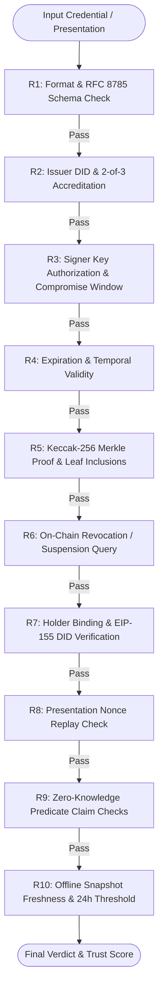
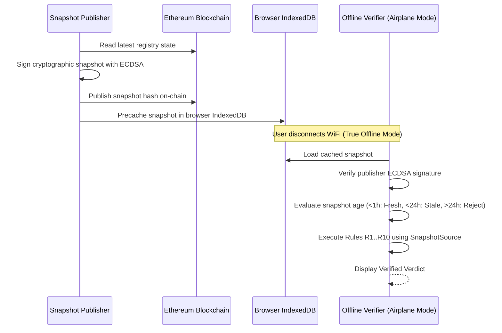

# TrustMesh Architecture Specification

TrustMesh is a decentralized institutional trust infrastructure that enables universities, employers, and professional bodies to issue cryptographically signed, Merkle-committed credentials. Any third-party verifier can verify these credentials against an on-chain Ethereum Trust Registry **without contacting the issuing institution** and **without placing personal data on-chain**.

---

## 1. System Overview & Core Tenets

```
                 +-------------------------------------------------------+
                 |              Accreditation Multi-Sig                  |
                 |     (2-of-3 Accreditor Signatures Required)          |
                 +---------------------------+---------------------------+
                                             |
                                             v
                 +-------------------------------------------------------+
                 |           Ethereum Trust Registry Contract            |
                 |  - Accredited Institutions (Active / Suspended / Rev)  |
                 |  - Active Signer Keys & Compromise Timestamps          |
                 |  - Anchored Merkle Roots (Individual & Batches)        |
                 |  - Revocation & Suspension Records                    |
                 |  - Signed Offline Snapshot Publications                |
                 |  - Guardian Social Recovery & Timelocks               |
                 +---------------------------+---------------------------+
                                             ^
                     +-----------------------+-----------------------+
                     |                                               |
                     | Direct JSON-RPC                               | Direct JSON-RPC
                     |                                               |
     +---------------+---------------+               +---------------+---------------+
     |   Independent Browser Mode    |               |         Backend Engine        |
     |   (Direct to RPC / Infura)    |               |  (Fastify Node + SQLite Index)|
     +---------------+---------------+               +---------------+---------------+
                     ^                                               ^
                     |                                               |
                     +-----------------------+-----------------------+
                                             |
                                  +----------+----------+
                                  | Decentralized       |
                                  | Verifier Interface  |
                                  | (Dual Engine Parity)|
                                  +---------------------+
```

### Core Cryptographic Principles
1. **Zero Personal Data On-Chain**: The Ethereum smart contract stores only 32-byte hashes (`keccak256`), Merkle roots, status enums, and decentralized identifiers (`DIDs`). Personal student or employee data never touches the mempool or public blockchain.
2. **RFC 8785 Canonical JSON**: To guarantee deterministic leaf hashing regardless of programming language or JSON serialization quirks, all field objects are formatted per JSON Canonicalization Scheme (RFC 8785).
3. **Dual Verification Architecture**:
   - **Backend Engine**: Rapid lookup through an indexed SQLite mirror.
   - **Independent Browser Engine**: Verifies directly against Ethereum JSON-RPC with zero backend dependencies, guaranteeing censorship resistance.
   - **Engine Parity**: Both engines produce identical verdicts (`VALID`, `VALID_WITH_WARNINGS`, `SUSPICIOUS`, `INVALID`) and identical rule logs (R1..R10).
4. **True Offline Mode (PWA)**: Verifies credentials in remote field settings or airplane mode using signed snapshot files cached in browser IndexedDB.

---

## 2. On-Chain Smart Contract Layer

The smart contract layer is implemented in Solidity 0.8.24 (`TrustRegistry.sol`) with custom error handling for maximum gas efficiency:

### Institutional Governance & Accreditation
- **Registration**: An institution registers its DID and name hash with an admin address.
- **2-of-3 Accreditation Consensus**: An institution remains `Pending` until at least 2 distinct accredited authorities submit on-chain approvals (`approveInstitution`).
- **Authorization Enforcement**: If an unauthorized party attempts to approve an institution, the transaction reverts with `NotAccreditor()`.

### Signer Key Management
- An institution registers public signing keys (`registerKey`).
- Keys transition through `Active`, `Suspended`, `Revoked`, and `Retired`.
- When revoking a leaked key, the institution specifies a `compromisedAt` unix timestamp. Credentials signed before this timestamp remain `VALID`; credentials signed after this timestamp are classified as `SUSPICIOUS`.

### Merkle Commitments & Credential Anchoring
- Single Credential Anchoring: Emits `CredentialAnchored(credId, root, keyAddr)`.
- Batch Credential Anchoring: Emits `BatchAnchored(batchId, batchRoot, count, keyAddr)`.
- Revocation & Suspension: Emits `CredentialRevoked(credId, reasonCode)` and `CredentialSuspended(credId)`.
- **Ownership Verification**: If Institution B attempts to revoke Institution A's credential, the contract strictly reverts with custom error:
  ```solidity
  error NotIssuerOfCredential(bytes32 credId, bytes32 callerId, bytes32 issuerId);
  ```

---

## 3. Cryptographic Verification Pipeline (Rules R1 - R10)

The core verification engine executes 10 deterministic mathematical rules in sequence:



| Rule | Name | Evaluated Constraint | Fails When |
| :--- | :--- | :--- | :--- |
| **R1** | Format & Signature | RFC 8785 schema canonicalization and EIP-191 ECDSA signature recovery | Signature mutated or malformed JSON |
| **R2** | Issuer Accreditation | Institution status on Trust Registry and 2-of-3 accreditor consensus | Issuer unapproved, suspended, or rogue |
| **R3** | Signer Key Status | Key is mapped to institution; checks against `compromisedAt` | Key revoked prior to issuance timestamp |
| **R4** | Temporal Expiration | Compares current or `asOf` timestamp against `expirationDate` | Credential has expired |
| **R5** | Merkle Tree Proof | Recomputes Keccak-256 leaf hashes with salts; verifies Merkle proof | Any field value tampered or mutated |
| **R6** | On-Chain Revocation | Queries contract revocation mapping and reason codes | Credential was revoked or suspended |
| **R7** | Holder Binding | Validates presentation was signed by holder DID matching credential | Impersonator presenting stolen credential |
| **R8** | Nonce Freshness | Compares presentation nonce against verifier challenge | Replayed or omitted challenge nonce |
| **R9** | Predicate Proofs | Evaluates zero-knowledge predicate assertions (e.g. CGPA >= 8) | Predicate condition fails or proof invalid |
| **R10**| Snapshot Freshness | Validates publisher signature and checks snapshot age (<24h) | Snapshot expired or publisher unrecognized |

---

## 4. Privacy & Selective Disclosure

TrustMesh supports zero-knowledge selective disclosure using salted leaf hashes:

1. **Salted Decomposition**:
   $$Leaf_i = \text{keccak256}(\text{canonicalize}(\{ field_i: value_i, salt_i: salt_i \}))$$
2. **Selective Reveal**: The holder reveals only the chosen subset of field values and salts, alongside the Merkle inclusion audit path for each disclosed leaf.
3. **Hidden In Wallet**: Non-disclosed attributes remain strictly inside the holder's browser IndexedDB. Verifiers receive the Merkle audit path to verify that the undisclosed fields reconcile with the on-chain root, without ever learning their values.
4. **Predicate Claims**: Holders can prove `cgpa >= 8.0` or `age >= 18` using cryptographically attested predicate commitments without revealing their actual CGPA or birthdate.

---

## 5. Offline Verification (PWA Architecture)


